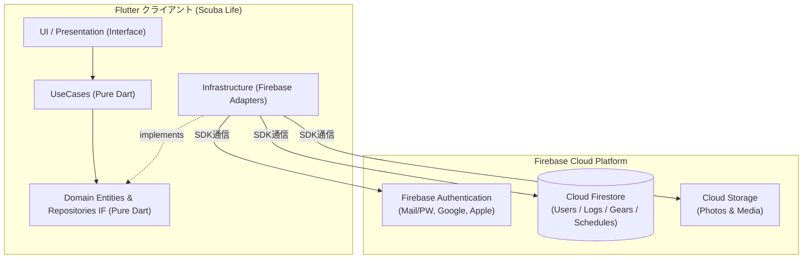
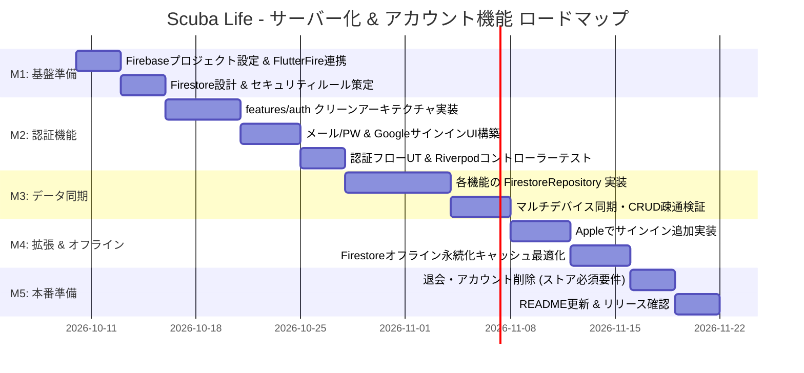

# アカウント登録・サーバーデータ管理 導入計画書 & アーキテクチャ設計 (Firebase編)

本ドキュメントは、**Scuba Life** アプリケーションにアカウント登録（サインアップ/サインイン）機能を新設し、各種データ（ログブック・機材・予定・スポット）を **Firebase (Authentication & Cloud Firestore)** で一元管理・同期するための全体設計、ディレクトリ構成、マイルストーン、および実装手順をまとめたものです。

---

## 1. 決定事項サマリー

ユーザーヒアリングに基づき、以下の方針で決定・合意しました：

1. **インフラ・バックエンド基盤**:
   - **Firebase (Google Cloud エコシステム)** を採用。
   - 認証: **Firebase Authentication**
   - データベース: **Cloud Firestore (NoSQL ドキュメント指向DB)**
   - ファイル保存: **Firebase Cloud Storage** (将来のログ写真・ライセンス画像用)
2. **サポートする認証方式**:
   - 【必須・先行実装】**メールアドレス ＋ パスワード認証**
   - 【必須・先行実装】**Google サインイン**
   - 【追加フェーズ】**Apple でサインイン** (iOS App Store 申請要件)
3. **オフライン方針**:
   - **フェーズ分け対応**: まずはオンライン前提で確実な認証とFirestore同期基盤を完成させ、次フェーズでFirestoreのオフライン永続化キャッシュや未同期バッジ表示を最適化。

---

## 2. 全体システムアーキテクチャ

Firebaseのエコシステムを活用しつつ、クライアント側は**クリーンアーキテクチャ（Clean Architecture）**を徹底して外部SDKをインフラ層に閉じ込めます。



### クリーンアーキテクチャの責務分離（フレームワーク非依存の原則）
- **Domain 層 (Pure Dart)**:
  - `UserAccount`, `DiveLog`, `GearItem` 等のエンティティ。Firebase SDKのクラス（`User`, `DocumentSnapshot` 等）は**一切持ち込みません**。
  - リポジトリインターフェース（`AuthRepository`, `DiveLogRepository`）を定義。
- **UseCase 層 (Pure Dart)**:
  - サインアップ、サインイン、ログ保存などの業務手順をカプセル化。テスト時はリポジトリをFake/Mockに差し替えて100%単体テスト可能。
- **Infrastructure 層 (Firebase 実装)**:
  - `firebase_auth`, `cloud_firestore` のSDK依存をすべてこの層に閉じ込めます。
  - Firestoreの `DocumentSnapshot` / `Map<String, dynamic>` と Domain Entity との相互変換（DTOマッピング）を担当。
- **Interface / UI 層 (Riverpod)**:
  - `AuthController` で認証状態（未ログイン・ログイン済み・ローディング・エラー）を管理し、ログイン画面やメイン画面を制御。

---

## 3. Cloud Firestore データモデル設計

Firestoreはドキュメント指向NoSQLであるため、**ユーザー単位のサブコレクション構造**を採用します。これによりセキュリティルールが極めてシンプルかつ堅牢になり、データ漏洩をDBレベルで防止できます。


### Firestore セキュリティルール（Security Rules）基本方針
```javascript
rules_version = '2';
service cloud.firestore {
  match /databases/{database}/documents {
    // ユーザー固有データ（サブコレクション）: 本人のみ読み書き可能
    match /users/{userId}/{document=**} {
      allow read, write: if request.auth != null && request.auth.uid == userId;
    }
    
    // ダイビングスポット共通マスタ: 認証済みユーザーは読み取り可能、書き込みは要管理者権限または特定条件
    match /dive_spots/{spotId} {
      allow read: if request.auth != null;
      allow write: if request.auth != null; // ユーザー追加スポットの許容
    }
  }
}
```

---

## 4. クライアント側（Flutter）ディレクトリ構成

Clean Architecture + Feature-First に従い、新規機能モジュール `lib/features/auth/` を追加します。

```text
lib/
├── app/
│   ├── app.dart                            # Auth状態に応じて Home / SignInPage を切り替え
│   └── routes.dart                         # 画面遷移ルーティング
├── features/
│   ├── auth/                               # ★新規追加: 認証機能
│   │   ├── domain/
│   │   │   ├── entities/user_account.dart  # ユーザー情報 (Pure Dart)
│   │   │   ├── errors/auth_failure.dart    # 認証エラー定義 (PW不一致、ネットワークエラー等)
│   │   │   └── repositories/auth_repository.dart # 抽象リポジトリIF
│   │   ├── usecase/
│   │   │   ├── sign_in_with_email.dart     # メールログイン
│   │   │   ├── sign_up_with_email.dart     # メール新規登録
│   │   │   ├── sign_in_with_google.dart    # Googleサインイン
│   │   │   ├── sign_out.dart               # サインアウト
│   │   │   ├── send_password_reset.dart    # パスワードリセット
│   │   │   └── watch_auth_state.dart       # ログイン状態のStream監視
│   │   ├── interface/
│   │   │   ├── controllers/auth_controller.dart # Riverpod StateNotifier
│   │   │   └── views/
│   │   │       ├── sign_in_page.dart       # サインイン画面
│   │   │       ├── sign_up_page.dart       # 新規登録画面
│   │   │       ├── profile_page.dart       # アカウント設定・ログアウト
│   │   │       └── password_reset_page.dart# パスワード再設定画面
│   │   └── infrastructure/
│   │       ├── datasources/firebase_auth_datasource.dart # FirebaseAuth, GoogleSignInラッパー
│   │       └── repositories/firebase_auth_repository.dart# リポジトリ実装
│   │
│   ├── logbook/
│   │   └── infrastructure/
│   │       ├── repositories/in_memory_dive_log_repository.dart # テスト用保持
│   │       └── repositories/firestore_dive_log_repository.dart # ★新規: Firestore同期実装
│   │
│   ├── my_gear/
│   │   └── infrastructure/
│   │       └── repositories/firestore_gear_repository.dart     # ★新規: Firestore同期実装
│   │
│   ├── schedule/
│   │   └── infrastructure/
│   │       └── repositories/firestore_schedule_repository.dart # ★新規: Firestore同期実装
│   │
│   └── dive_spot/
│       └── infrastructure/
│           └── repositories/firestore_dive_spot_repository.dart# ★新規: Firestore同期実装
```

---

## 5. プロジェクト推進マイルストーン & ロードマップ

段階的なリリースと品質担保のため、5つのマイルストーンで進行します。



### マイルストーン詳細一覧

| マイルストーン | 期間目安 | 主なタスク | 完了基準（Definition of Done） |
| :--- | :--- | :--- | :--- |
| **M1: Firebase環境構築 & セキュリティルール策定** | 1週間 | - Firebaseコンソールでのプロジェクト作成<br>- `flutterfire configure` によるAndroid/iOS接続設定<br>- Firestore コレクション設計 & セキュリティルール作成<br>- Google Cloud Console でのOAuthクライアント設定 | Firebase CLIおよびエミュレータ/実環境で接続が通り、セキュリティルールがテストできること。 |
| **M2: 認証機能の実装（メール/PW + Google）** | 1.5週間 | - `features/auth` のドメイン/ユースケース/インフラ/UI実装<br>- メールアドレス登録・ログイン・ログアウト<br>- Googleサインイン連携<br>- ログイン状態によるアプリ起点ルーティング制御<br>- Riverpod Notifierのユニットテスト作成 | 新規ユーザー登録、ログイン、Google連携、ログアウトが実機/エミュレータでスムーズに行えること。 |
| **M3: 各種データのクラウド永続化（Firestore同期）** | 2週間 | - `FirestoreDiveLogRepository`<br>- `FirestoreGearRepository`<br>- `FirestoreScheduleRepository`<br>- `FirestoreDiveSpotRepository`<br>- リポジトリProviderのFirestore版への差し替え | ログ登録や機材変更を行うと即座にFirestoreに反映され、別端末・再起動後もデータが完全に復元されること。 |
| **M4: Appleサインイン追加 & オフライン最適化** | 1週間 | - Apple Sign-In の実装（iOS審査必須対応）<br>- Firestore のローカルキャッシュ永続化検証<br>- 機内モード（圏外）での読み書き動作確認 | iOSでAppleサインインが動作し、機内モード時でもアプリがクラッシュせず直前のログを閲覧・追記できること。 |
| **M5: アカウント管理・セキュリティ監査・公開準備** | 1週間 | - アカウント削除機能（Apple/Googleガイドライン準拠）<br>- パスワード再設定メール送信機能<br>- 利用規約・プライバシーポリシー画面<br>- README の機能一覧・設計セクション更新 | アカウント削除を含む全規約対応が完了し、READMEが最新状態に同期され、テストがオールグリーンであること。 |

---

## 6. 次のアクション（M1の着手に向けて）

M1の具体的な着手にあたり、以下の準備を行います：
1. **Firebase プロジェクトの用意**:
   - Googleアカウントにて Firebase Console でプロジェクトを作成（または既存プロジェクトを指定）
2. **FlutterFire CLI の実行準備**:
   - `firebase-tools` および `flutterfire_cli` のインストール
3. **必要なパッケージの追加 (`pubspec.yaml`)**:
   - `firebase_core`, `firebase_auth`, `cloud_firestore`, `google_sign_in`, `sign_in_with_apple`
