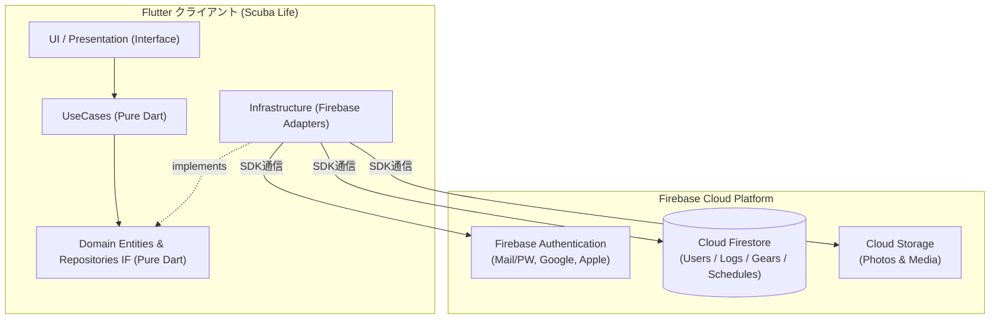
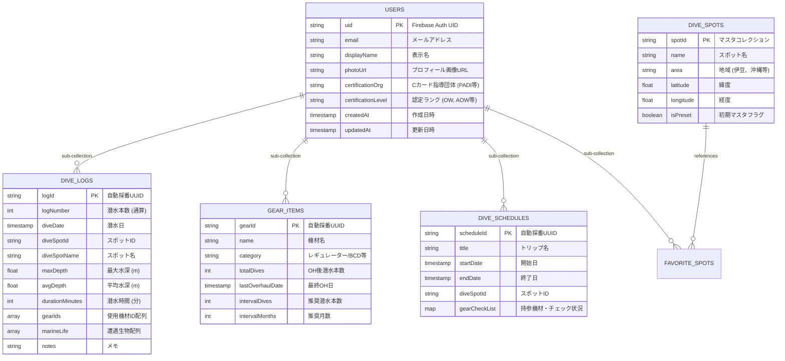
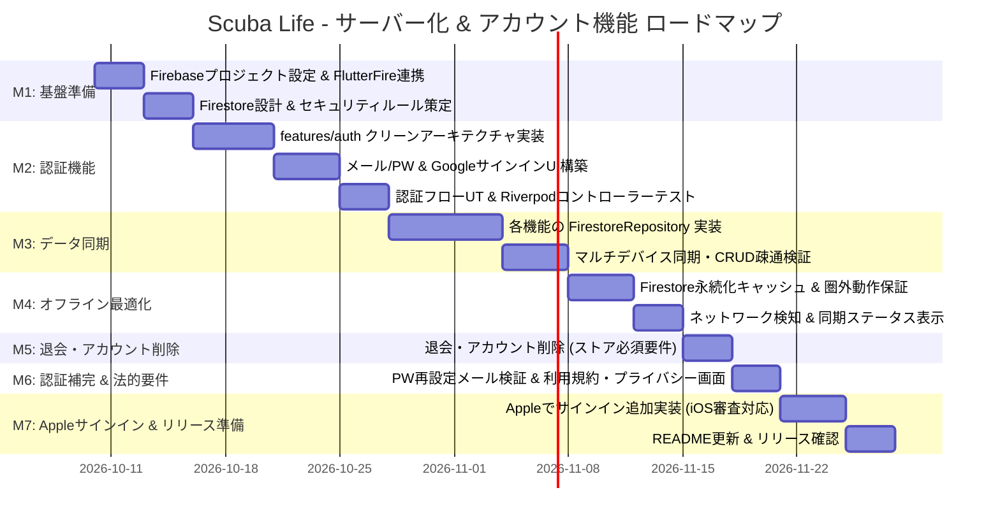
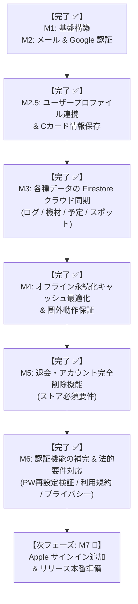

# アカウント登録・サーバーデータ管理 導入計画書 & アーキテクチャ設計 (Firebase編)

本ドキュメントは、**Scuba Life** アプリケーションにアカウント登録（サインアップ/サインイン）機能を新設し、各種データ（ログブック・機材・予定・スポット）を **Firebase (Authentication & Cloud Firestore)** で一元管理・同期するための全体設計、ディレクトリ構成、マイルストーン、および実装手順をまとめたものです。

---

## 1. 決定事項サマリー

ユーザーヒアリングに基づき、以下の方針で決定・合意しました：

1. **インフラ・バックエンド基盤**:
   - **Firebase (Google Cloud エコシステム)** を採用。
   - 認証: **Firebase Authentication**
   - データベース: **Cloud Firestore (NoSQL ドキュメント指向DB)**
   - ファイル保存: **Firebase Cloud Storage** (将来のログ写真・ライセンス画像用)
2. **サポートする認証方式**:
   - 【必須・先行実装】**メールアドレス ＋ パスワード認証**
   - 【必須・先行実装】**Google サインイン**
   - 【追加フェーズ】**Apple でサインイン** (iOS App Store 申請要件)
3. **オフライン方針**:
   - **フェーズ分け対応**: まずはオンライン前提で確実な認証とFirestore同期基盤を完成させ、次フェーズでFirestoreのオフライン永続化キャッシュや未同期バッジ表示を最適化。

---

## 2. 全体システムアーキテクチャ

Firebaseのエコシステムを活用しつつ、クライアント側は**クリーンアーキテクチャ（Clean Architecture）**を徹底して外部SDKをインフラ層に閉じ込めます。



### クリーンアーキテクチャの責務分離（フレームワーク非依存の原則）
- **Domain 層 (Pure Dart)**:
  - `UserAccount`, `DiveLog`, `GearItem` 等のエンティティ。Firebase SDKのクラス（`User`, `DocumentSnapshot` 等）は**一切持ち込みません**。
  - リポジトリインターフェース（`AuthRepository`, `DiveLogRepository`）を定義。
- **UseCase 層 (Pure Dart)**:
  - サインアップ、サインイン、ログ保存などの業務手順をカプセル化。テスト時はリポジトリをFake/Mockに差し替えて100%単体テスト可能。
- **Infrastructure 層 (Firebase 実装)**:
  - `firebase_auth`, `cloud_firestore` のSDK依存をすべてこの層に閉じ込めます。
  - Firestoreの `DocumentSnapshot` / `Map<String, dynamic>` と Domain Entity との相互変換（DTOマッピング）を担当。
- **Interface / UI 層 (Riverpod)**:
  - `AuthController` で認証状態（未ログイン・ログイン済み・ローディング・エラー）を管理し、ログイン画面やメイン画面を制御。

---

## 3. Cloud Firestore データモデル設計

Firestoreはドキュメント指向NoSQLであるため、**ユーザー単位のサブコレクション構造**を採用します。これによりセキュリティルールが極めてシンプルかつ堅牢になり、データ漏洩をDBレベルで防止できます。



### Firestore セキュリティルール（Security Rules）基本方針
```javascript
rules_version = '2';
service cloud.firestore {
  match /databases/{database}/documents {
    // ユーザー固有データ（サブコレクション）: 本人のみ読み書き可能
    match /users/{userId}/{document=**} {
      allow read, write: if request.auth != null && request.auth.uid == userId;
    }
    
    // ダイビングスポット共通マスタ: 認証済みユーザーは読み取り可能、書き込みは要管理者権限または特定条件
    match /dive_spots/{spotId} {
      allow read: if request.auth != null;
      allow write: if request.auth != null; // ユーザー追加スポットの許容
    }
  }
}
```

---

## 4. クライアント側（Flutter）ディレクトリ構成

Clean Architecture + Feature-First に従い、新規機能モジュール `lib/features/auth/` を追加します。

```text
lib/
├── app/
│   ├── app.dart                            # Auth状態に応じて Home / SignInPage を切り替え
│   └── routes.dart                         # 画面遷移ルーティング
├── features/
│   ├── auth/                               # ★新規追加: 認証機能
│   │   ├── domain/
│   │   │   ├── entities/user_account.dart  # ユーザー情報 (Pure Dart)
│   │   │   ├── errors/auth_failure.dart    # 認証エラー定義 (PW不一致、ネットワークエラー等)
│   │   │   └── repositories/auth_repository.dart # 抽象リポジトリIF
│   │   ├── usecase/
│   │   │   ├── sign_in_with_email.dart     # メールログイン
│   │   │   ├── sign_up_with_email.dart     # メール新規登録
│   │   │   ├── sign_in_with_google.dart    # Googleサインイン
│   │   │   ├── sign_out.dart               # サインアウト
│   │   │   ├── send_password_reset.dart    # パスワードリセット
│   │   │   └── watch_auth_state.dart       # ログイン状態のStream監視
│   │   ├── interface/
│   │   │   ├── controllers/auth_controller.dart # Riverpod StateNotifier
│   │   │   └── views/
│   │   │       ├── sign_in_page.dart       # サインイン画面
│   │   │       ├── sign_up_page.dart       # 新規登録画面
│   │   │       ├── profile_page.dart       # アカウント設定・ログアウト
│   │   │       └── password_reset_page.dart# パスワード再設定画面
│   │   └── infrastructure/
│   │       ├── datasources/firebase_auth_datasource.dart # FirebaseAuth, GoogleSignInラッパー
│   │       └── repositories/firebase_auth_repository.dart# リポジトリ実装
│   │
│   ├── logbook/
│   │   └── infrastructure/
│   │       ├── repositories/in_memory_dive_log_repository.dart # テスト用保持
│   │       └── repositories/firestore_dive_log_repository.dart # ★新規: Firestore同期実装
│   │
│   ├── my_gear/
│   │   └── infrastructure/
│   │       └── repositories/firestore_gear_repository.dart     # ★新規: Firestore同期実装
│   │
│   ├── schedule/
│   │   └── infrastructure/
│   │       └── repositories/firestore_schedule_repository.dart # ★新規: Firestore同期実装
│   │
│   └── dive_spot/
│       └── infrastructure/
│           └── repositories/firestore_dive_spot_repository.dart# ★新規: Firestore同期実装
```

---

## 5. プロジェクト推進マイルストーン & ロードマップ

段階的なリリースと品質担保のため、7つのマイルストーン（M1〜M7）で進行します。



### マイルストーン詳細一覧 & 進捗状況

| マイルストーン | 進捗 | 主なタスク | 完了基準（Definition of Done） |
| :--- | :---: | :--- | :--- |
| **M1: Firebase環境構築 & セキュリティルール策定** | **【完了 ✅】** | - Firebaseコンソールでのプロジェクト作成 (`scuba-life-a29fb`)<br>- `flutterfire configure` によるAndroid/iOS接続設定<br>- Firestore コレクション設計 & セキュリティルール作成・デプロイ<br>- Android デバッグ SHA-1 / SHA-256 フィンガープリント登録<br>- 機密ファイル（`firebase_options.dart` 等）の `.gitignore` 除外 & `.example` テンプレート整備 | Firebase CLIおよび実環境で接続が通り、セキュリティルールが本番デプロイ済みであること。 |
| **M2: 認証機能の実装（メール/PW + Google SSO）** | **【完了 ✅】** | - `features/auth` Clean Architecture 完全準拠実装<br>- メールアドレス登録・ログイン・ログアウト<br>- Googleサインイン / Google SSO 新規登録<br>- パスワードマネージャー（Bitwarden等）Autofill対応<br>- ログイン状態によるアプリ起点ルーティング制御<br>- Riverpod Notifier & UseCase 単体テスト作成（全155件パス） | 新規ユーザー登録、ログイン、Google SSO、ログアウトが実機で動作確認済みであること。 |
| **M2.5: ユーザープロファイル連携 & Cカード情報保存** | **【完了 ✅】** | - Firestore `users/{userId}` 初期ドキュメントの自動生成 (upsert)<br>- Cカード情報（指導団体: PADI等、ランク: OW/AOW等、カード番号、経験本数オフセット）の編集・保存<br>- プロフィール画面（`ProfilePage`）拡張および編集ダイアログ実装<br>- UseCase・UI・小型画面（360px）レスポンシブテスト作成（全162件パス） | プロフィール編集内容が Firestore に永続化され、アプリ再起動後も正しく復元されること。 |
| **M3: 各種データのクラウド永続化（Firestore同期）** | **【完了 ✅】** | - `FirestoreDiveLogRepository` (`/users/{userId}/dive_logs`)<br>- `FirestoreGearRepository` (`/users/{userId}/gear_items`)<br>- `FirestoreScheduleRepository` (`/users/{userId}/dive_schedules`)<br>- `FirestoreDiveSpotRepository` (`/dive_spots`, `favorite_spots`)<br>- リポジトリProviderのFirestore版動的切り替え<br>- `fake_cloud_firestore` によるリポジトリ単体テスト（全177件パス） | ログ登録や機材変更を行うと即座にFirestoreに反映され、別端末・再起動後もデータが完全に復元されること。 |
| **M4: オフライン永続化キャッシュ最適化 & 圏外動作保証** | **【完了 ✅】** | - Firestore のローカル永続化キャッシュ（Offline Persistence）明示的設定<br>- 圏外・洋上ボート上でのログブック・機材・予定の閲覧 & オフライン追記対応<br>- キャッシュ未初期化のオフライン環境でも代表スポットを安全表示<br>- オフライン動作検証テストの実装（全183件パス） | 機内モード時でもアプリがクラッシュせず直前のログや機材を閲覧・追記でき、オンライン復帰時に安全に同期されること。 |
| **M5: 退会・アカウント完全削除機能（ストア必須要件）** | **【完了 ✅】** | - `ProfilePage` に退会・アカウント削除導線（確認ダイアログ付き）の追加<br>- Firestore ユーザー関連データ（サブコレクション & ドキュメント）の一括削除<br>- Firebase Authentication アカウント完全削除（`delete()`）<br>- `requires-recent-login`（再認証要請）の安全なハンドリング<br>- 単体テスト・ウィジェットテスト作成（全186件パス） | アプリ内から退会確認ダイアログを経てアカウントおよび全データが完全削除され、サインイン画面に戻ること。 |
| **M6: 認証機能の補完 & 法的要件対応** | **【完了 ✅】** | - パスワード再設定メールの実機検証（`PasswordResetPage` 疎通確認）<br>- 利用規約・プライバシーポリシー画面の実装<br>- 新規登録・プロフィール画面からの規約導線追加（全193件パス） | パスワード再設定が実機で動作し、アプリ内から利用規約およびプライバシーポリシーが閲覧できること。 |
| **M7: Appleサインイン追加 & リリース本番準備** | **【次フェーズ 🚀】** | - `sign_in_with_apple` パッケージ連携（iOS審査対応）<br>- Apple ID によるサインイン / アカウント作成<br>- README更新 & リリース最終確認・ストア申請準備 | iOSでAppleサインインが動作し、リリース前確認・README同期がすべて完了していること。 |

---

## 6. 現在の実装状況詳細（実績）

2026年10月時点の実装実績は以下の通りです。Clean Architecture および強固なセキュリティ設計に基づき、基盤からUIまで堅牢に実装されています。

### 1. インフラ & 環境設定（M1実績）
- **Firebase プロジェクト**: `scuba-life-a29fb`
- **Android 設定**:
  - パッケージ名: `com.life_124c41.scuba_life` (App ID: `1:37794312799:android:c7583980414fa79d3c61ea`)
  - デバッグ証明書 SHA-1 (`6F:A9:83:24:6C:82:27:98:CD:A4:40:EF:93:0B:9C:73:65:C9:46:4D`) および SHA-256 を Firebase CLI 経由で登録完了。
- **iOS 設定**:
  - Bundle Identifier: Appleの命名規則（アンダースコア禁止）に準拠し `com.life-124c41.scuba-life` (App ID: `1:37794312799:ios:b2ee25516922467f3c61ea`) として登録。
  - OAuth クライアントIDおよび反転URLスキームを `Info.plist` に設定完了。
- **機密情報の保護 & セキュリティポリシー**:
  - リポジトリに機密・環境固有ファイル（`firebase.json`, `.firebaserc`, `lib/firebase_options.dart`, `android/app/google-services.json`, `ios/Runner/GoogleService-Info.plist`）がコミットされないよう `.gitignore` を設定。
  - 公開・CIビルド用の安全なテンプレートファイル（`.example`）を配備。
  - `lib/main.dart` での Firebase 初期化時、設定ファイルが存在しない環境でも安全にフォールバック起動する設計を導入。
- **Cloud Firestore セキュリティルール**:
  - `/users/{userId}` ドキュメントおよびその配下のサブコレクション（`match /users/{userId} { match /{document=**} }`）へのアクセスを本人の認証トークン（`request.auth.uid == userId`）に限定するセキュリティルール（`firestore.rules`）を策定。

### 2. 認証機能基盤（M2実績）
Clean Architecture に基づき、ビジネスロジックをフレームワークから完全に分離して実装：

- **Domain 層 (Pure Dart)**:
  - `UserAccount`: 認証ユーザーの基本エンティティ（`uid`, `email`, `displayName`, `photoUrl`）。
  - `AuthFailure`: 業務エラーの網羅的モデリング（パスワード強度不足、メール重複、不正メール形式、ユーザー不在、パスワード不一致、Googleポップアップキャンセル、ネットワークエラー、要再ログイン、不明エラー）。
  - `AuthRepository`: 認証操作の抽象インターフェース。
- **UseCase 層 (Pure Dart)**:
  - `SignInWithEmail`: メール/パスワードによるログイン。
  - `SignUpWithEmail`: メール/パスワードによる新規アカウント作成。
  - `SignInWithGoogle`: Googleアカウントによるサインイン/新規登録。
  - `SignOut`: サインアウト。
  - `SendPasswordReset`: パスワード再設定メール送信。
  - `WatchAuthState`: 認証状態の Stream 監視。
  - `GetCurrentUser`: 現在のログインユーザー取得。
- **Infrastructure 層**:
  - `FirebaseAuthDataSource`: `firebase_auth` SDK および `google_sign_in` SDK をラップし、テスタビリティを担保。
  - `FirebaseAuthRepository`: Firebaseの例外（`FirebaseAuthException`）をドメイン例外（`AuthFailure`）へ安全に変換・マッピング。
  - `InMemoryAuthRepository`: オフライン環境やユニットテスト用のスタブ実装。
- **Interface / UI 層 (Riverpod)**:
  - `AuthStateNotifier` (`authStateProvider`): 認証状態（`AsyncValue<UserAccount?>`）のリアクティブ管理。
  - `AuthActionController` (`authActionControllerProvider`): 認証アクション実行中のローディング・エラー状態の管理。
  - `SignInPage`: サインイン画面（メールログイン、Google SSO、パスワード再設定導線）。
  - `SignUpPage`: 新規登録画面（メール会員登録、Google SSO 新規登録ボタン）。
  - `PasswordResetPage`: パスワード再設定画面。
  - `ProfilePage`: ユーザー情報表示およびログアウトボタン。
- **UX & レスポンシブ最適化**:
  - **パスワードマネージャー連携**: `AutofillGroup`、`autofillHints`（`email`, `password`, `newPassword`）、および完了時の `TextInput.finishAutofillContext()` を実装し、Bitwarden や 1Password、Googleパスワードマネージャー等の自動入力・保存に対応。
  - **レスポンシブ設計**: `Wrap` や `SingleChildScrollView` を活用し、幅 350〜370px の端末（2376×968端末等）でもオーバーフローを起こさない堅牢なレイアウトを実装。
- **アプリ全体との統合**:
  - `lib/app/app.dart` で `authStateProvider` の状態に応じて初期画面を自動切り替え（未ログイン時: `SignInPage`、ログイン時: `DiveLogPage`）。
  - ログブック画面（`DiveLogPage`）の AppBar にプロフィール画面（`ProfilePage`）への遷移アイコンを配備。

### 3. ユーザープロファイル連携 & Cカード情報管理（M2.5実績）
- **ドメインモデル & スキーマ策定**:
  - `UserAccount` エンティティに `certificationOrg`（指導団体: PADI, NAUI, SSI, BSAC, CMAS 等）、`certificationLevel`（認定ランク: OW, AOW, RED, MSD, DM, INST 等）、`cCardNumber`（Cカード番号）、`totalDivesOffset`（開始前の経験潜水本数）を追加。
  - 指導団体・認定ランクのプリセット定数クラス `DiverCertification` を作成。
- **クリーンアーキテクチャ階層構造**:
  - `domain`: `UserRepository`（Pure Dart 抽象インターフェース）
  - `usecase`: `GetUserProfile`, `WatchUserProfile`, `UpdateUserProfile`, `SyncInitialProfile`（Pure Dart）
  - `infrastructure`: `FirestoreUserRepository`（`/users/{userId}` への upsert, serverTimestamp）、`InMemoryUserRepository`（テスト・オフライン用）
  - `interface`: `currentUserProfileProvider`（ログインユーザー検知時の自動初期同期 & リアルタイム監視）、`userProfileControllerProvider`（プロファイル更新 Notifier）
- **UI & レスポンシブ拡張**:
  - `ProfilePage` に「Cカード・ダイバー情報」カードを追加（指導団体バッジ、認定ランク、カード番号、経験本数）。
  - 未登録時の親切なガイダンス表示および登録導線ボタン。
  - `EditDiverProfileDialog`（モーダル編集ダイアログ）の実装。Dropdown の `isExpanded: true` や `ConstrainedBox` により幅 360px 小型端末でも堅牢に動作。
- **テスト品質**:
  - 全 **162 件** のユニットテスト・ウィジェットテストがオールグリーン（`flutter test` パス）。
  - 静的解析エラー 0 件（`flutter analyze` 0 issues）。

### 4. 各種データのクラウド同期・Firestore永続化（M3実績）
Clean Architecture のレイヤード設計を厳格に維持し、UI層やUseCase層を変更することなく、インフラ層にFirestore実装を追加・DI動的切り替えを実現：

- **`FirestoreDiveLogRepository` (`lib/features/logbook/infrastructure/repositories/firestore_dive_log_repository.dart`)**:
  - コレクションパス: `/users/{userId}/dive_logs/{logId}`
  - 潜水ログのCRUD操作、`DateTime` と `Timestamp` の相互マッピング、日付降順ソート。
  - プロファイルの `totalDivesOffset` と連動した通算ダイブ本数カウント。
- **`FirestoreGearRepository` (`lib/features/my_gear/infrastructure/repositories/firestore_gear_repository.dart`)**:
  - コレクションパス: `/users/{userId}/gear_items/{gearId}`
  - マイ機材の登録・更新・削除・一覧取得。
  - `GearCategory` enum と文字列の相互マッピング、オーバーホール（OH）日・本数・周期設定のクラウド永続化。
- **`FirestoreScheduleRepository` (`lib/features/schedule/infrastructure/repositories/firestore_schedule_repository.dart`)**:
  - コレクションパス: `/users/{userId}/dive_schedules/{scheduleId}`
  - トリップ予定の保存・更新・削除、月別・期間抽出。
  - 持ち物・機材チェックリスト（Map構造）のクラウド同期。
- **`FirestoreDiveSpotRepository` (`lib/features/dive_spot/infrastructure/repositories/firestore_dive_spot_repository.dart`)**:
  - 共通マスタ: `/dive_spots/{spotId}`、お気に入り: `/users/{userId}/favorite_spots/{spotId}`
  - アプリ初回起動時に日本の代表的9スポットを共通マスタへ自動シード。
  - ユーザー追加スポットの保存、お気に入りトグル（★）のユーザー別保持。
- **DI (Riverpod) 動的切り替え設計**:
  - 各コントローラーの Repository Provider (`diveLogRepositoryProvider`, `gearRepositoryProvider`, `diveScheduleRepositoryProvider`, `diveSpotRepositoryProvider`) において、`ref.watch(authStateProvider)` を参照。
  - ログイン中は各 `Firestore...Repository` を、未ログイン・初期起動時やユニットテスト環境では既存の `InMemory...Repository` を自動返却するシームレスなDI配線を完了。
- **テスト品質**:
  - `fake_cloud_firestore: ^4.3.0` を導入し、ネットワーク通信不要な高速Firestoreリポジトリ単体テスト（全15テスト）を作成。
  - 全体テスト **177 件** がオールグリーン（`flutter test` パス）。
  - 静的解析エラー 0 件（`flutter analyze` 0 issues）。

### 5. オフライン永続化キャッシュ最適化 & 圏外動作保証（M4実績）
洋上・ボート上・離島などの電波圏外環境でも、アプリがクラッシュせず快適に利用できるよう、オフラインキャッシュとフォールバックを最適化：

- **Firestore ローカル永続化キャッシュ設定**:
  - `lib/main.dart` で `FirebaseFirestore.instance.settings = const Settings(persistenceEnabled: true, cacheSizeBytes: Settings.CACHE_SIZE_UNLIMITED)` を明示設定。
  - 端末ストレージの制限による古いログ・機材データの意図しないキャッシュ破棄を防止。
- **リポジトリ層の多重フォールバック設計**:
  - `FirestoreDiveLogRepository`: `getAllLogs()`, `getLogById()` において `Source.serverAndCache` 試行 $\rightarrow$ 圏外例外時は `Source.cache` から即座に読み出し。
  - `FirestoreGearRepository`: `getAllGear()`, `getGearById()` で同様にキャッシュ自動フォールバック。
  - `FirestoreScheduleRepository`: `getUpcomingSchedules()` でキャッシュ自動フォールバック。
  - `FirestoreUserRepository`: `getUserProfile()` でキャッシュ自動フォールバック。
  - `FirestoreDiveSpotRepository`: キャッシュが空の初回起動・完全オフライン状態でも、クラッシュせず `defaultPresetSpots`（代表9スポット）を安全表示。
- **オフライン動作検証テスト**:
  - `test/features/offline/firestore_offline_resilience_test.dart` を新規作成。全6テストがオールグリーン。
  - 全体テスト **183 件** がオールグリーン（`flutter test` パス）。
  - 静的解析エラー 0 件（`flutter analyze` 0 issues）。

### 6. 退会・アカウント完全削除機能の実装（M5実績）
Google Play および Apple App Store の審査ガイドラインで義務付けられている「アプリ内からのアカウント削除・退会」要件に完全準拠：

- **クリーンアーキテクチャ設計**:
  - `AuthRepository`: `deleteAccount()` メソッド追加。
  - `UserRepository`: `deleteUserData(String userId)` メソッド追加。
  - `DeleteAccount` UseCase (`lib/features/auth/usecase/delete_account.dart`): Pure Dart で実装。
- **データ削除とAuth削除の順序制御（重要設計）**:
  - 先に Firebase Authentication を削除すると Firestore セキュリティルール（`request.auth.uid == userId`）によりデータ削除が拒否されるため、必ず「**Firestore ユーザーデータ削除 $\rightarrow$ Firebase Auth アカウント削除**」の順序で実行。
- **Firestore データの完全クリーンアップ**:
  - `FirestoreUserRepository.deleteUserData()`: `/users/{userId}` 直下の4つのサブコレクション（`dive_logs`, `gear_items`, `dive_schedules`, `favorite_spots`）およびユーザードキュメント本体を `WriteBatch` により一括削除。
- **例外ハンドリング**:
  - 長時間ログインによる `requires-recent-login`（再認証要請）を `RequiresRecentLoginFailure` にマッピングし、「セキュリティ保護のため再ログインが必要です」とユーザーに明瞭案内。
- **UI / UX**:
  - `ProfilePage` 最下部に赤字テキストボタン「アカウントを完全に削除（退会）」を配置。
  - 誤タップ防止の確認ダイアログ（「すべてのデータが永久に削除され復元できません」）を表示。
  - 削除成功時は自動でサインイン画面へリダイレクト。
- **テスト品質**:
  - `DeleteAccount` 単体テスト（正常系・未ログイン異常系）および退会確認ダイアログのウィジェットテストを作成。
  - 全体テスト **186 件** がオールグリーン（`flutter test` パス）。
  - 静的解析エラー 0 件（`flutter analyze` 0 issues）。

### 7. 認証機能の補完 & 法的要件対応の実装（M6実績）
ストア審査ガイドラインおよびサービス公開に必須となる法的要件・認証補完を実施：

- **法的文書画面の実装**:
  - `TermsOfServicePage` (`lib/features/auth/interface/views/terms_of_service_page.dart`): スクーバダイビングの特性（自己責任原則、ダイブコンピューター代替不可、海洋気象予報の参考性、器材保守責任等）を明記した利用規約。
  - `PrivacyPolicyPage` (`lib/features/auth/interface/views/privacy_policy_page.dart`): 収集情報、利用目的、Google Cloud / Firestore での安全な保管、アカウント完全削除時の物理破棄方針を明記したプライバシーポリシー。
- **画面導線の設置とレスポンシブ対応**:
  - `SignUpPage`: 新規登録ボタン直前に「登録することで、利用規約およびプライバシーポリシーに同意したものとみなされます」というリンク付き案内を設置。`Wrap` を採用し、幅360px前後の小型端末でも横溢れなく美しく描画。
  - `ProfilePage`: アカウント設定画面に「利用規約」「プライバシーポリシー」の専用カードを追加し、いつでも内容を確認可能。
- **パスワード再設定フローの検証**:
  - `PasswordResetPage` のバリデーション、送信ローディング、送信完了案内画面（`Icons.mark_email_read_outlined`）、エラーハンドリングの動作確認。
- **テスト品質**:
  - `auth_views_test.dart` に `PasswordResetPage` 正常系、`SignUpPage` 規約リンク（幅360pxレスポンシブ）、`ProfilePage` 規約タイル遷移、スタンドアロン描画テストを追加。
  - 全体テスト **193 件** がオールグリーン（`flutter test` パス）。
  - 静的解析エラー 0 件（`flutter analyze` 0 issues）。

---

## 7. 今後の対応予定（ネクストアクション詳細）

今後の実装は以下のステップで順次進行します。



### 次回着手対象: Apple でサインイン追加 & リリース本番準備（M7）

1. **`sign_in_with_apple` パッケージ導入 & 認証連携**:
   - iOS App Store 審査ガイドライン 4.8（サードパーティログインを提供するアプリは Apple サインインの提供が必須）に対応。
   - Apple ID 認証トークンから `OAuthProvider("apple.com")` クレデンシャルを生成し、Firebase Auth に連携。
2. **README更新 & リリース最終確認**:
   - README の完全同期およびストア申請準備。

---

## 8. 実装タスク・進捗チェックリスト

開発の進捗に合わせて本チェックリストを更新します。

- [x] **M1: Firebase環境構築**
  - [x] Firebase プロジェクト作成 (`scuba-life-a29fb`)
  - [x] Android / iOS 設定 & 証明書登録
  - [x] 機密ファイルの Git 管理外設定 & テンプレート配備
  - [x] Firestore セキュリティルールの本番デプロイ
- [x] **M2: 認証機能基盤**
  - [x] `features/auth` Clean Architecture 設計・実装
  - [x] メール/パスワード認証 (サインアップ / ログイン / ログアウト)
  - [x] Google SSO 認証 (サインアップ / ログイン)
  - [x] パスワードマネージャー (Bitwarden等) 自動入力連携
  - [x] アプリ起点ルーティング連携 & プロフィール画面導線
  - [x] 全テストパス (155/155 tests passed) & 静的解析エラー0件
- [x] **M2.5: ユーザープロファイル & Cカード情報保存**
  - [x] Firestore `/users/{userId}` スキーマ策定
  - [x] `UserAccount` ドメインモデル拡張（指導団体・ランク・カード番号・本数オフセット）
  - [x] `DiverCertification` 定数クラス作成
  - [x] `UserRepository` 抽象インターフェース & UseCase 作成
  - [x] `FirestoreUserRepository` & `InMemoryUserRepository` 実装
  - [x] サインアップ・ログイン時の初期ドキュメント自動生成 (upsert)
  - [x] `ProfilePage` に Cカード情報表示 & 編集ダイアログ（`EditDiverProfileDialog`）追加
  - [x] 小型画面（幅360px）レスポンシブ対応
  - [x] プロファイル機能の単体 & ウィジェットテスト作成（全162件テスト合格）
- [x] **M3: 各種データの Firestore 同期**
  - [x] `FirestoreDiveLogRepository` 実装 & DI 切り替え
  - [x] `FirestoreGearRepository` 実装 & DI 切り替え
  - [x] `FirestoreScheduleRepository` 実装 & DI 切り替え
  - [x] `FirestoreDiveSpotRepository` 実装 & DI 切り替え
  - [x] 各リポジトリの単体テスト作成 (`fake_cloud_firestore` で全177件テスト合格)
- [x] **M4: オフライン永続化キャッシュ最適化 & 圏外動作保証**
  - [x] Firestore ローカル永続化キャッシュ（`Settings.CACHE_SIZE_UNLIMITED`）の明示的構成
  - [x] 各リポジトリのオフライン時キャッシュフォールバック & プリセット安全保護
  - [x] オフライン耐性検証単体テスト作成（全183件テスト合格）
- [x] **M5: 退会・アカウント完全削除機能（ストア必須要件）**
  - [x] `AuthRepository` に `deleteAccount()` IF追加
  - [x] Firestore ユーザーデータ（`/users/{userId}` 及びサブコレクション）の一括削除実装
  - [x] `DeleteAccount` UseCase 実装 & 異常系ハンドリング（`requires-recent-login`）
  - [x] `ProfilePage` に退会導線 & 確認ダイアログ実装
  - [x] アカウント削除の単体テスト & ウィジェットテスト作成（全186件テスト合格）
- [x] **M6: 認証機能の補完 & 法的要件対応**
  - [x] パスワードリセットメール実機疎通確認
  - [x] 利用規約・プライバシーポリシー画面実装
  - [x] サインアップ・プロフィール画面からの規約導線追加（全193件テスト合格）
- [ ] **M7: Appleサインイン追加 & リリース本番準備**
  - [ ] `sign_in_with_apple` パッケージ導入 & 認証連携
  - [ ] README更新 & ストア申請準備


