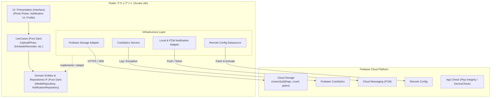
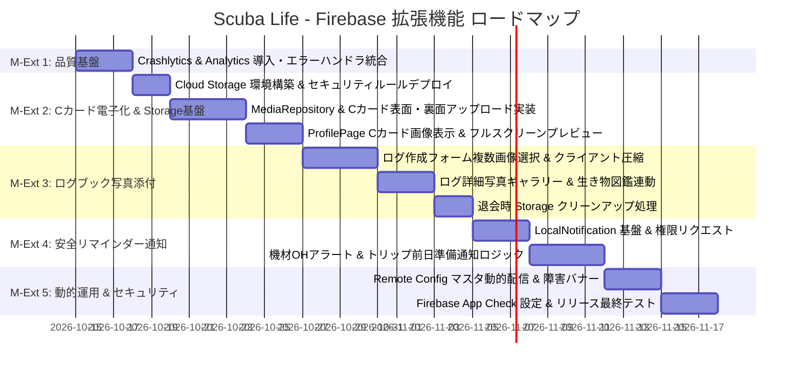

# Firebase 拡張機能導入計画書 & アーキテクチャ設計
## (Cloud Storage / Crashlytics / リマインダー / Remote Config / App Check)

本ドキュメントは、**Scuba Life** アプリケーションにおける既存の Firebase 基盤（Authentication & Cloud Firestore）を拡張し、ユーザー体験の飛躍的向上、オフライン・洋上環境での堅牢な品質監視、安全管理のためのリマインダー通知、および動的マスタ運用を実現するための全体設計、アーキテクチャ方針、データモデル、マイルストーン、および実装手順を定義した計画書です。

---

## 1. 導入背景 & 目的サマリー

Scuba Life は、スクーバダイバー向けのオールインワン支援アプリとして、ログブック記録・スケジュール管理・マイ機材管理（OH目安）・海洋気象確認・出会った生き物図鑑を実装しています。

既存の「アカウント・Firestore同期基盤」に加え、スクーバダイビング特有の利用シーン（**水中写真の思い出、ダイビング受付でのCカード提示、機材整備不良の防止、離島・ボート上の不安定な通信**）を踏まえ、以下の Firebase エコシステムを拡張導入します。

### 導入機能とダイバー価値

| 導入機能 / サービス | 対象ユースケース | ダイバー視点の提供価値 |
| :--- | :--- | :--- |
| **① Firebase Cloud Storage** | 水中写真・生物写真、Cカード（表/裏）、機材保証書・領収書 | ログや図鑑に写真を添付。ショップ受付時にCカードをスマホから電子提示可能。 |
| **② Firebase Crashlytics & Analytics** | アプリ品質監視、利用傾向把握 | ボート上や離島などの不安定回線で発生する例外を即座に検知・修正。 |
| **③ ローカル通知 & Cloud Messaging (FCM)** | 機材オーバーホール推奨日・本数超過アラート、ツアー前日チェックリスト未完了通知 | 機材の整備不良による水難事故を未然に防止。トリップ前のパッキング忘れを解消。 |
| **④ Firebase Remote Config** | スポットマスタ動的追加、緊急海況メンテ告知 | ストア再審査なしで最新人気スポットを即時配信。API障害時の案内バナー掲出。 |
| **⑤ Firebase App Check** | Firestore / Storage のアクセス保護 | 悪意ある第三者によるAPI濫用やスクレイピング、不要なクラウド課金発生を防止。 |

---

## 2. 全体システムアーキテクチャ

Clean Architecture の原則に基づき、**ビジネスロジック（Domain / UseCase）は Firebase SDK に一切依存させず、Pure Dart で維持** します。すべての Firebase SDK 呼び出しは Infrastructure 層のアダプターに閉じ込めます。



### レイヤード設計の責務境界
1. **Domain 層 (Pure Dart)**:
   - `MediaAttachment`: 添付画像エンティティ（ID、URL、ローカルパス、キャプション、作成日時）。
   - `NotificationSchedule`: リマインダー設定エンティティ（通知ID、タイトル、本文、トリガー日時）。
   - 抽象リポジトリ: `MediaRepository`, `NotificationRepository`, `AppConfigRepository`。
2. **UseCase 層 (Pure Dart)**:
   - `UploadLogPhoto`, `DeleteLogPhoto`, `UploadCCardImage`
   - `ScheduleGearOverhaulAlert`, `ScheduleTripReminder`
   - `FetchDynamicSpotMaster`
3. **Infrastructure 層 (Firebase / プラットフォーム依存)**:
   - `FirebaseStorageDatasource`: `firebase_storage` によるアップロード、URL取得、削除。
   - `LocalNotificationDatasource`: `flutter_local_notifications` による端末スケジュール通知。
   - `FirebaseCrashlyticsService`: グローバルクラッシュ捕捉、カスタムキー（ユーザーID・オフライン状態）付与。
   - `FirebaseRemoteConfigService`: 動的パラメータ取得とキャッシュ管理。
4. **Interface / UI 層 (Riverpod)**:
   - レスポンシブな画像グリッド（`Wrap` / `mainAxisExtent` 適用）、アップロード進捗インジケーター、通知設定画面。

---

## 3. Cloud Storage 設計 & セキュリティルール

### 3.1 ストレージ・パス構造
Firestore のユーザーサブコレクション構造と完全に同期したパス設計を採用します。

```text
gs://<YOUR_PROJECT_ID>.firebasestorage.app/
└── users/
    └── {userId}/
        ├── profile/
        │   ├── avatar.webp
        │   ├── c_card_front.webp     # Cカード表面
        │   └── c_card_back.webp      # Cカード裏面
        ├── dive_logs/
        │   └── {logId}/
        │       ├── {photoId_1}.webp  # 水中写真
        │       └── {photoId_2}.webp
        └── gear_items/
            └── {gearId}/
                ├── gear_photo.webp   # 機材本体写真
                └── warranty.webp     # 保証書・OH明細書
```

### 3.2 Cloud Storage セキュリティルール (`storage.rules`)
- **本人のみアクセス許可**: 認証トークンの `request.auth.uid` と一致するパスポリシー。
- **画像形式・容量制限**: 最大 10MB、画像 MIME タイプ（`image/*`）に厳格制限。

```javascript
rules_version = '2';
service firebase.storage {
  match /b/{bucket}/o {
    // ユーザー固有ディレクトリ
    match /users/{userId}/{allPaths=**} {
      allow read: if request.auth != null && request.auth.uid == userId;
      allow write: if request.auth != null 
                   && request.auth.uid == userId
                   && request.resource.size < 10 * 1024 * 1024 // 10MB以内
                   && request.resource.contentType.matches('image/.*'); // 画像のみ
      allow delete: if request.auth != null && request.auth.uid == userId;
    }
  }
}
```

### 3.3 クライアント側の画像最適化方針
- 高解像度カメラ（TG-6やGoPro等）の写真（20MB超）をそのままアップロードすると、ボート上などの低速回線でタイムアウトし、ストレージ容量も圧迫します。
- クライアント側（Infrastructure層）でアップロード前に自動リサイズ（長辺 1920px、品質 80% の JPEG / WebP 変換）を行い、ファイルサイズを数百KB〜1MB程度に圧縮して送信します。
- 表示側は `cached_network_image` を使用し、一度読み込んだ画像はローカルにキャッシュして洋上オフライン時でも閲覧可能にします。

---

## 4. データモデル拡張（Firestore スキーマ）

各ドメインエンティティおよび Firestore ドキュメントスキーマに画像URLや通知関連フィールドを追加します。

### 1. `users/{userId}` (ユーザープロファイル)
```json
{
  "uid": "abc123xyz",
  "displayName": "Ocean Diver",
  "certificationOrg": "PADI",
  "certificationLevel": "AOW",
  "cCardFrontUrl": "https://firebasestorage.googleapis.com/.../c_card_front.webp",
  "cCardBackUrl": "https://firebasestorage.googleapis.com/.../c_card_back.webp",
  "updatedAt": "2026-10-13T12:00:00Z"
}
```

### 2. `users/{userId}/dive_logs/{logId}` (ログブック)
```json
{
  "logId": "log-001",
  "diveSpotName": "大瀬崎 湾内",
  "maxDepth": 21.5,
  "photoUrls": [
    "https://firebasestorage.googleapis.com/.../photo_1.webp",
    "https://firebasestorage.googleapis.com/.../photo_2.webp"
  ]
}
```

### 3. `users/{userId}/gear_items/{gearId}` (マイ機材)
```json
{
  "gearId": "gear-001",
  "name": "レギュレーター Legend",
  "photoUrl": "https://firebasestorage.googleapis.com/.../gear_photo.webp",
  "warrantyPhotoUrl": "https://firebasestorage.googleapis.com/.../warranty.webp"
}
```

---

## 5. 詳細機能仕様 & 設計

### Feature 1: Cloud Storage メディア管理機能

#### ユースケースとUI導線
1. **Cカード電子提示 (ProfilePage)**:
   - 「Cカード・ライセンス証」カードに「表面」「裏面」の画像登録・閲覧エリアを配備。
   - タップで拡大フルスクリーンビュー（ピンチイン/アウト可能）。
   - オフライン時でも端末キャッシュから即座に表示。
2. **水中写真ギャラリー (DiveLogFormPage & DetailPage)**:
   - ログ作成・編集画面で複数写真（最大5枚）を選択・プレビュー・削除。
   - ログ詳細画面でカルーセルまたはグリッドサムネイル表示。
   - 写真をタップすると生き物図鑑やスポット名とともに全画面表示。
3. **退会時（M5）のクリーンアップ連携**:
   - `DeleteAccount` UseCase 実行時、Firestore 削除に加えて Storage の `/users/{userId}` 配下全ファイルの一括削除を実行。

---

### Feature 2: アプリ品質・監視基盤 (Crashlytics & Analytics)

#### 設計と導入方針
1. **グローバルエラー捕捉**:
   - `FlutterError.onError`: UI描画エラーを Crashlytics に自動送信。
   - `PlatformDispatcher.instance.onError`: 非同期処理やリポジトリ層でキャッチされなかった未処理例外を捕捉。
2. **カスタムキー・メタデータ付与**:
   - `FirebaseCrashlytics.instance.setCustomKey('is_offline', isOffline);`
   - `FirebaseCrashlytics.instance.setUserIdentifier(userId);`
   - 電波が途切れる洋上で発生したのか、通常のオンライン環境なのかをクラッシュレポート上で判別可能に。
3. **Analytics イベント測定**:
   - `log_created`: 潜水本数、最大深度、スポット名
   - `sac_calculated`: SACレート値
   - `c_card_registered`: 団体名、ランク
   - `gear_oh_recorded`: OH実施記録

---

### Feature 3: リマインダー & 通知基盤 (Safety Reminder)

#### ユースケースとトリガー
1. **オーバーホール（OH）期限アラート**:
   - **条件**: 次回推奨OH日まで残り30日、または推奨本数まで残り10本に達した時。
   - **通知内容**: 「【機材メンテナンス】レギュレーターの次回OH目安まであと30日です。安全なダイビングのために点検をご検討ください」。
2. **トリップ前日パッキングリマインダー**:
   - **条件**: 登録されたダイビング予定（`DiveSchedule`）の前日 18:00。
   - **通知内容**: 「【明日はダイビング予定日です】『白浜ツアー』の機材チェックリストは 2/4 完了しています。忘れ物はありませんか？」。
3. **実装アーキテクチャ**:
   - オフライン環境でも確実に動作するよう、まずは `flutter_local_notifications` による端末内ローカル通知を基盤として実装。
   - 将来的な海況警報等のサーバー発信通知を見据え、`firebase_messaging` の受信ハンドラーを用意。

---

### Feature 4: Remote Config & App Check

#### 動的パラメータ設計
1. **Remote Config パラメータ一覧**:
   - `preset_dive_spots_version`: プリセットスポットマスタのバージョン番号。
   - `dynamic_dive_spots_json`: アプリ更新なしで追加された新規ダイビングスポットのJSON配列。
   - `maintenance_banner_enabled`: 緊急メンテナンスバナー表示フラグ（海況API障害時等）。
   - `maintenance_banner_message`: バナー表示文言。
2. **Firebase App Check 導入**:
   - Android: **Play Integrity** プロバイダー
   - iOS: **DeviceCheck** または **App Attest** プロバイダー
   - Web / デバッグ環境: **Debug Provider** (CIや開発時のトークン許可)
   - Firestore および Storage への未認証・外部からの悪意あるリクエストをブロック。

---

## 6. プロジェクト推進マイルストーン & ロードマップ

本拡張計画は、リスクを最小化し確実に価値を提供するため、5つのマイルストーン（M-Ext 1 〜 M-Ext 5）に分割して推進します。



### マイルストーン詳細一覧

| マイルストーン | 主なタスク | 完了基準（Definition of Done） |
| :--- | :--- | :--- |
| **M-Ext 1: 品質基盤 (Crashlytics & Analytics)** | - `firebase_crashlytics`, `firebase_analytics` パッケージ導入<br>- `main.dart` でのグローバル例外ハンドラー登録<br>- オフラインステータス・ユーザーIDのCrashlyticsキー連携<br>- 主要アクション（ログ作成、SAC計算）のイベント測定 | 故意にスローした例外が Crashlytics ダッシュボードで正しく捕捉・分類され、ビルドエラーなく全テストが通ること。 |
| **M-Ext 2: Cカード電子化 & Storage基盤（+ プロフィール写真対応）** | - `firebase_storage` 導入 & `storage.rules` デプロイ<br>- `MediaRepository` 抽象IF & `FirebaseStorageRepository` 実装<br>- 画像選択・自動リサイズ/圧縮ロジック（Pure Dart UseCase / Infra）<br>- `ProfilePage` に Cカード表・裏の登録/表示/拡大プレビュー追加<br>- プロフィール写真（アバター）の変更・削除・拡大表示機能の実装<br>- ユニットテスト & 小型端末（360px）レスポンシブテスト | Cカードの表面・裏面画像およびプロフィール写真が Storage に保存・復元され、電波オフライン時でもキャッシュから正しく閲覧できること。 |
| **M-Ext 3: ログブック写真添付 & 退会連動** | - `DiveLog` エンティティへの `photoUrls` 追加<br>- `DiveLogFormPage` での複数写真選択・削除チップUI<br>- `DiveLogDetailPage` での写真カルーセル/グリッド表示<br>- `DeleteAccount` UseCase でのユーザーStorageフォルダ完全消去 | ログ登録時に水中写真が複数枚保存され、詳細画面で美しく表示されること。退会時にStorage上の画像も物理削除されること。 |
| **M-Ext 4: 安全リマインダー通知 (OH & トリップ)** | - `flutter_local_notifications` 連携基盤構築<br>- 通知権限リクエストダイアログの実装<br>- OH推奨期限（30日前 / 残り10本）自動スケジュール<br>- ダイビング予定前日 18:00 の準備リマインダー登録<br>- 通知タップ時の該当画面ディープリンク遷移 | 機材登録や予定作成時にローカル通知が正しくスケジュールされ、指定日時に端末へ通知が届くこと。 |
| **M-Ext 5: 動的運用 & セキュリティ (Remote Config & App Check)** | - `firebase_remote_config` 導入 & スポットマスタ動的マージ<br>- 海況API障害時のお知らバナーUI<br>- `firebase_app_check` 導入（Play Integrity / DeviceCheck）<br>- README更新 & リリース前最終E2E検証 | アプリを更新せずにリモートから新規スポットが反映されること。正規アプリ以外からのアクセスが拒否されること。 |

---

## 7. テスト方針 & 品質基準

プロジェクトのグローバルルールおよびレイアウト規約に厳格に従います。

### 1. ユニットテスト (Pure Dart UT)
- **UseCase 層**: `MediaRepository` や `NotificationRepository` のモック（Fake実装）を作成し、外部SDKなしで全ユースケースの 100% 網羅テストを実装。
- **画像圧縮・パス生成ロジック**: 許可拡張子の判定、ファイル名ハッシュ化などのドメインロジックをテスト。
- **Arrange / Act / Assert 形式** を徹底。

### 2. ウィジェットテスト & レスポンシブ検証
- **小型画面（幅 350〜370px）対応**: 画像一覧やCカードプレビューカードが狭小画面でも `RenderFlex overflow` を起こさないことを `tester.binding.setSurfaceSize(const Size(360, 800))` で検証。
- **`Wrap` の採用**: 写真サムネイルやアクションボタンの横並びには `Wrap(spacing: 8, runSpacing: 8)` を徹底。

---

## 8. 実装タスク・進捗チェックリスト

開発の進捗に合わせて本チェックリストを更新します。

- [x] **M-Ext 1: 品質基盤 (Crashlytics & Analytics) 【完了 ✅】**
  - [x] `firebase_crashlytics` & `firebase_analytics` パッケージ追加
  - [x] `main.dart` グローバルエラー捕捉ハンドラ実装 (`FlutterError.onError`, `PlatformDispatcher.instance.onError`)
  - [x] オフライン状態・Cカード情報・ユーザーIDメタデータ連携 (`monitoringSyncProvider`)
  - [x] 主要イベント（ログ作成・SAC計算・機材更新・タブ画面遷移）の計測配線
  - [x] 全205件テスト合格 & 解析エラー0件確認
- [x] **M-Ext 2: Cカード電子化 & Storage基盤（+ プロフィール写真対応） 【完了 ✅】**
  - [x] `firebase_storage` & `image_picker` パッケージ追加 & `storage.rules` 定義
  - [x] `MediaStorageRepository` & `ImagePickerService` 抽象インターフェース策定 (Pure Dart)
  - [x] `FirebaseMediaStorageRepository` & `DefaultImagePickerService` 実装
  - [x] `UserAccount` エンティティ拡張 (`cCardFrontUrl`, `cCardBackUrl`, `clearPhotoUrl`)
  - [x] `UploadCCardImage` & `DeleteCCardImage` UseCase 実装
  - [x] `UploadAvatarImage` & `DeleteAvatarImage` UseCase 実装
  - [x] `ProfilePage` に Cカード電子ライセンス証カード（`CCardImageCard`）およびフルスクリーン拡大ビューアー（`CCardFullScreenViewer`）追加
  - [x] `ProfileAvatarWidget` 実装（カメラ・ライブラリからの写真選択・変更、拡大表示、削除、アップロード中スピナー）
  - [x] 小型端末（幅360px）レスポンシブテスト & 単体テスト作成（全224件テスト合格 & 解析エラー0件）
- [x] **M-Ext 3: ログブック写真添付 & ストレージクリーンアップ 【完了 ✅】**
  - [x] `DiveLog` エンティティ拡張 (`photoUrls: List<String>`)
  - [x] `FirestoreDiveLogRepository` スキーママッピング更新
  - [x] `DiveLogFormPage` 複数写真ピッカーUI実装 (`DiveLogPhotoPickerWidget`)
  - [x] `DiveLogDetailPage` 写真ギャラリー & 拡大モーダル実装 (`DiveLogPhotoGalleryWidget`)
  - [x] `DeleteAccount` UseCase に Storage 画像完全消去処理を追加 (`mediaStorageRepository.deleteDirectory`)
  - [x] 単体テスト & ウィジェットテスト合格確認（写真追加・削除・退会ストレージ消去・360pxレスポンシブ）
- [x] **M-Ext 4: 安全リマインダー通知 (OH & トリップ) 【完了 ✅】**
  - [x] `flutter_local_notifications` & `timezone` パッケージ導入 & プラットフォーム権限設定 (`AndroidManifest.xml`)
  - [x] `NotificationRepository` 抽象IF & `FlutterLocalNotificationRepository` 実装 (Pure Dart & フォールバック完備)
  - [x] マイ機材OH目安（残り30日 / 残り10本）通知スケジュール連動 (`ScheduleGearOverhaulReminder` / `CancelGearOverhaulReminder`)
  - [x] ダイビング予定前日リマインダー通知連動 (`ScheduleTripPackingReminder` / `CancelTripPackingReminder`)
  - [x] 通知設定画面 (`NotificationSettingsPage`) & プロフィール画面への設定導線追加
  - [x] 通知スケジュール・キャンセル・設定UI単体 & 小型画面（幅360px）ウィジェットテスト作成（全257件テスト合格 & 解析エラー0件）
- [ ] **M-Ext 5: 動的運用 & セキュリティ (Remote Config & App Check)**
  - [ ] `firebase_remote_config` パッケージ導入
  - [ ] スポットマスタの動的取得 & ローカルマスタとのマージ実装
  - [ ] 緊急メンテナンスバナーUIの実装
  - [ ] `firebase_app_check` 設定 (Play Integrity / DeviceCheck)
  - [ ] README.md 更新 & 全体リグレッションテスト実施
